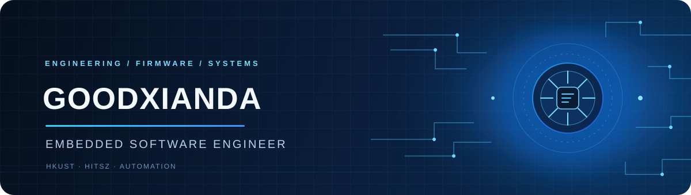

  

# 你好，我是 GoodXianDa 👋

### 嵌入式软件工程师 · Embedded Software Engineer

把软件带到真实硬件上，让每一次运行都稳定、可靠。

---

## 关于我 · About Me

- 🎓 **香港科技大学（HKUST）** — 电子工程硕士
- 🎓 **哈尔滨工业大学（深圳）** — 自动化本科
- 💻 **目前从事嵌入式软件开发**，专注于可靠、实用的软硬件系统
- 🌱 持续探索固件开发、系统集成与工程实践

## 关注方向 · Focus

<table>
  <tr>
    <td align="center" width="25%"><strong>⚙️ 固件开发</strong> Firmware Development</td>
    <td align="center" width="25%"><strong>⏱️ 实时系统</strong> Real-time Systems</td>
    <td align="center" width="25%"><strong>🔌 软硬件协同</strong> Hardware–Software Integration</td>
    <td align="center" width="25%"><strong>🧭 稳定与可靠</strong> Reliable Engineering</td>
  </tr>
</table>

## 一起交流 · Connect

欢迎交流嵌入式开发、自动化与工程实践。

  
  
  

  感谢来访 · Thanks for stopping by

